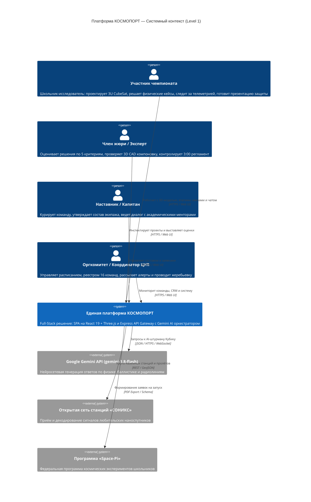

# Архитектурное руководство платформы КОСМОПОРТ (Cosmoport & CubeSat)

**Версия:** 2.0.0 (Unified Release)  
**Статус:** Канонический архитектурный стандарт объединенной платформы  
**Методология:** Clean Architecture (Роберт Мартин) + Domain-Driven Design (Эрик Эванс)  
**Репозиторий:** `spawnperm/cosmoport`

---

## 1. Контекстная модель системы (C4 Model Level 1: System Context)

Платформа **КОСМОПОРТ** — это интерактивная цифровая среда всероссийского школьного кейс-чемпионата по прикладной физике и орбитальной космонавтике, объединяющая соревновательные этапы, проектирование наноспутников формата CubeSat 3U и оркестрацию интеллектуальных сервисов.



---

## 2. Модель контейнеров (C4 Model Level 2: Containers)

```mermaid
C4Container
    title Платформа КОСМОПОРТ — Контейнеры (Level 2)
    Container(spa, "Cosmoport Frontend SPA", "React 19, TypeScript, Three.js, Tailwind v4", "Интерактивный 3D-пульт управления, симулятор телеметрии, график Ганта, Recharts аналитика, jsPDF генератор")
    Container(server, "Express API Gateway", "Express 4, TypeScript, @google/genai, WebSocket ws", "Роутинг запросов к AI-агенту, синхронизация комнат, CRM реестр, контроль лимитов, security headers")
    Container(sim, "Telemetry Simulator", "TypeScript Pure Domain", "Физически достоверный симулятор орбиты Кеплера 525 км, АКБ, теплового баланса и маяка AX.25")
    Container(scoring, "Domain Scoring & SPI Engine", "TypeScript Zero-dependency", "Расчет SPI, Earned Value, критериальный скоринг и валидация решений")

    Rel(spa, server, "API запросы и WebSocket аудио", "HTTP/1.1 & WSS :3000")
    Rel(spa, sim, "Поток телеметрических пакетов (1 Гц)", "React Hook / In-memory")
    Rel(spa, scoring, "Расчёт индексов расписания и баллов", "In-memory")
    Rel(server, gemini_ai, "Генерация текста и синтез", "Google GenAI SDK")
```

---

## 3. Выделенные Bounded Contexts (DDD)

Система декомпозирована на 6 изолированных ограниченных контекстов:

1. **Flight & Spacecraft Context (Борт и орбитальный полёт)**
   - Сущности: `CubeSat3DModel`, `SubsystemLayer` (OBC, EPS, ADCS, Radio, Payload), `TelemetryPacket`, `OrbitGroundTrack`.
   - Ответственность: Three.js визуализация, расчет орбитального движения и радиомаяка AX.25 на 437.425 МГц.

2. **Championship & Submissions Context (Кейс-чемпионат)**
   - Сущности: `Stage` (1: Матмодель, 2: 3D CAD, 3: Защита), `Submission`, `CaseTask` (банк 500 кейсов), `PresentationDeck` (3 слайда).
   - Ответственность: Жизненный цикл решений, черновики, прикрепление файлов расчётов.

3. **AI & Knowledge Context (Искусственный интеллект и база знаний)**
   - Сущности: `CubicMascot`, `LlmWikiArticle`, `QuizQuestion`, `VoiceAudioStream`.
   - Ответственность: Оркестрация модели `gemini-3.8-flash`, голосовой диалог, физический экзамен и офлайн-база знаний.

4. **Jury & Evaluation Context (Экспертиза и аналитика)**
   - Сущности: `ExpertEvaluation`, `CriterionScores`, `ScheduleBenchmark` (SPI, PV, EV, AC), `TeamRank`.
   - Ответственность: Оценочные ведомости, таймер регламента (3:00) и выгрузка CSV.

5. **Space-Pi & Community Context (Партнёрские программы и сообщество)**
   - Сущности: `SpacePiApplication`, `SoniksGroundStation`, `ForumTopic`, `MentorMessage`, `CertificateDoc`.
   - Ответственность: Оформление заявок на запуск наноспутников, форум и генерация официальных PDF-сертификатов (jsPDF).

6. **Crew & Sync Context (Экипаж и синхронизация)**
   - Сущности: `UserProfile`, `TeamRecord`, `RoomSyncToken`, `ConnectedMobileDevice`.
   - Ответственность: RBAC роли, синхронизация по коду комнаты и спаривание мобильных по QR-коду.
